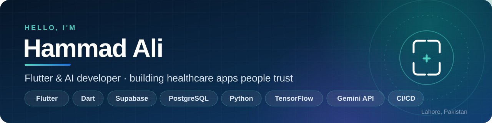
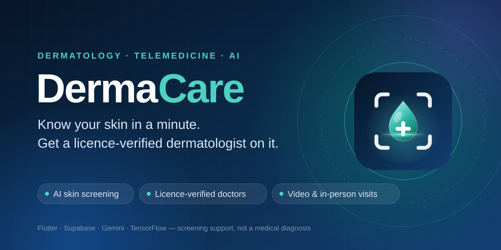

  

### About me

I build cross-platform mobile apps with **Flutter** and connect them to real
backends and **AI**. My focus is healthcare: products that have to be fast,
private and trustworthy, where the UX decides whether people actually use
them.

- 🩺 Currently building **DermaCare**, an AI skin-screening and dermatology telemedicine app
- 🧠 Interested in applied AI: vision models, LLM-assisted triage, safety rules around model output
- 🔐 Care about security by design: row-level security, server-side secrets, least privilege
- 🎨 Detail-oriented about UI/UX: motion, accessibility and design systems
- 📍 Lahore, Pakistan

### Featured project: DermaCare

**Scan a skin concern in about a minute, then get a licence-verified dermatologist on it.**
One Flutter codebase with patient, doctor and admin apps on Android, iOS and the web.

- **AI triage:** Gemini vision classifies photos into six condition groups with a strict JSON schema; blurry or non-skin photos are rejected with a retake tip; any meaningful cancer signal is always flagged for a doctor; retries and a fallback model keep scans working under load
- **Own model, too:** Flask + TensorFlow/Keras (VGG19 transfer learning) classifier server, used automatically when it's online
- **Secure backend:** Supabase Postgres with row-level security on every table, admin-verified doctors, private photo storage, Deno edge functions so no API key ships in the app
- **Full care loop:** booking with clash prevention, chat, Stream video calls, PDF reports, reviews, family profiles, emergency SOS
- **Craft:** a motion system, painted 3D visuals, skeleton loading, screen-reader labels and reduce-motion support
- **Quality:** 79 automated checks, including a 33-step live end-to-end suite covering RLS isolation, booking and account deletion; CI builds for APK, AAB and IPA

The repository is private. A demo is available on request.

### Tech I work with

  
  
  
  
  
  
  
  
  
  
  
  
  
  

### Let's connect

Open to collaborating on **Flutter** and **AI-for-health** projects. The
quickest way to reach me is through GitHub.
